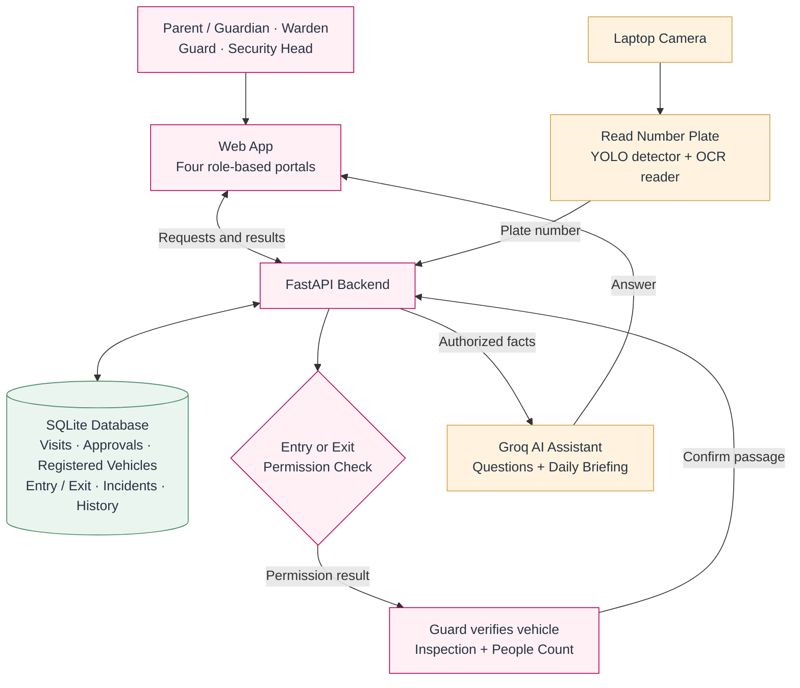

# AEMS — Simple System Architecture

The camera reads a vehicle number. The backend checks warden approvals or active registered-vehicle permission in the database. The guard verifies the vehicle, completes entry inspection, checks people counts and confirms passage. Visitor exit requires warden clearance and a matching entry/exit count. Recognition alone never opens the gate.

The AI assistant receives authorized aggregate facts for questions and daily briefings; it cannot approve vehicles or change records.
